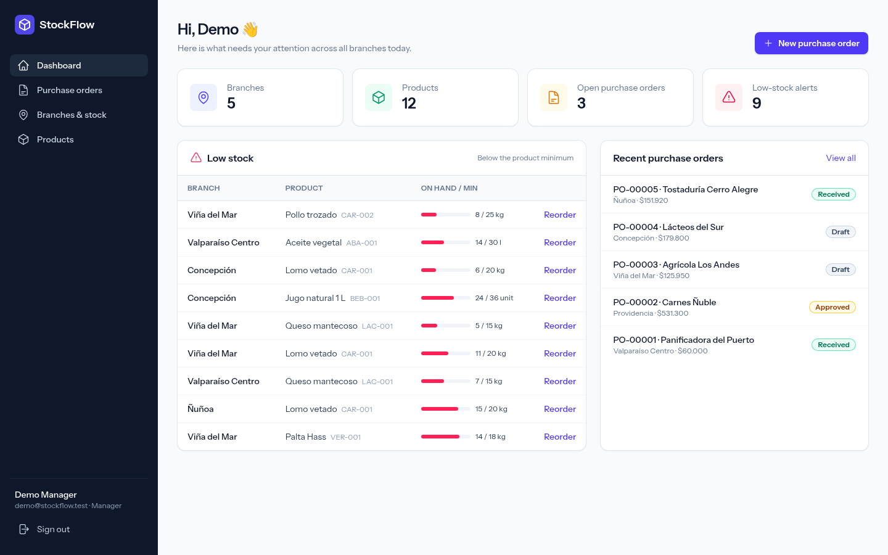
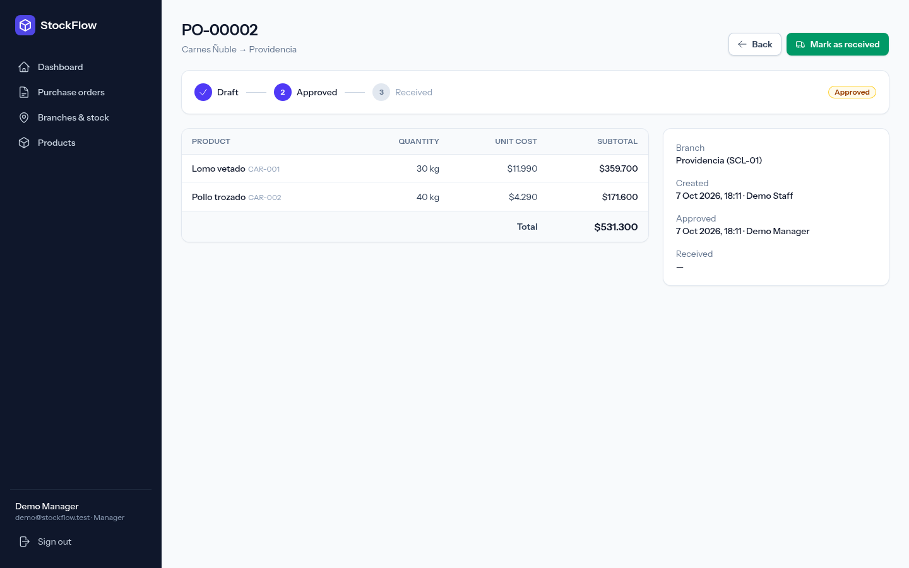
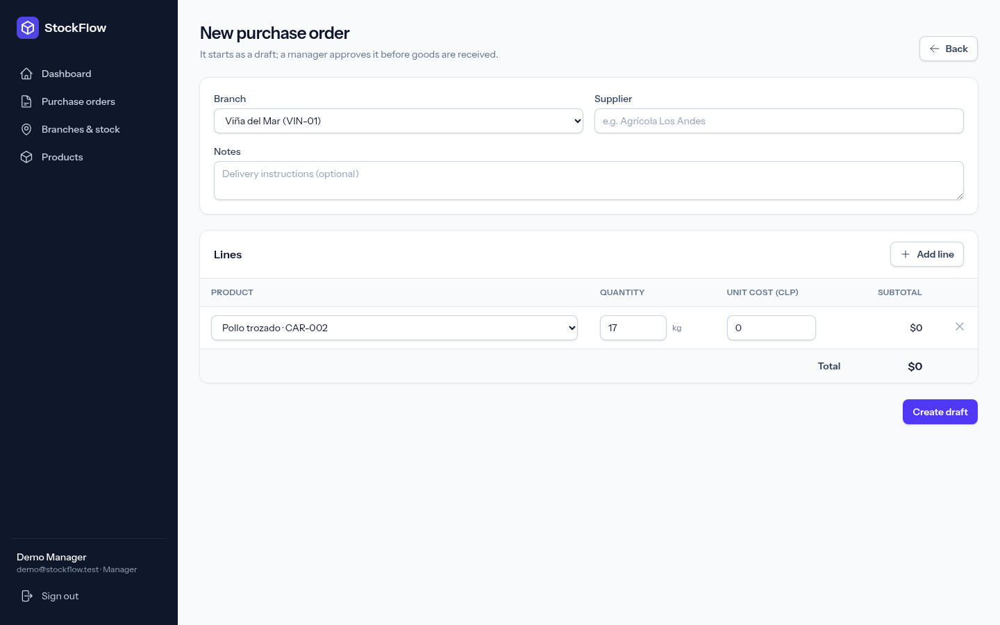
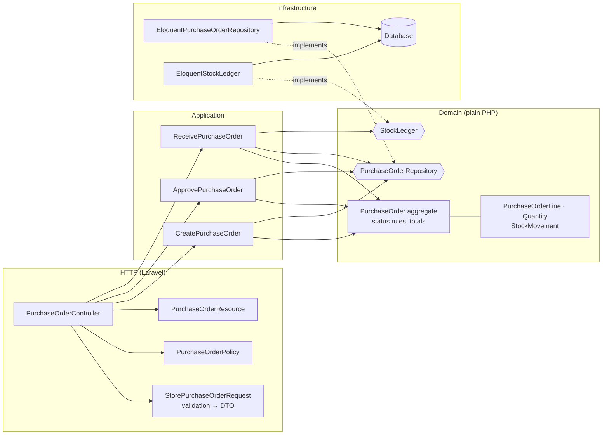
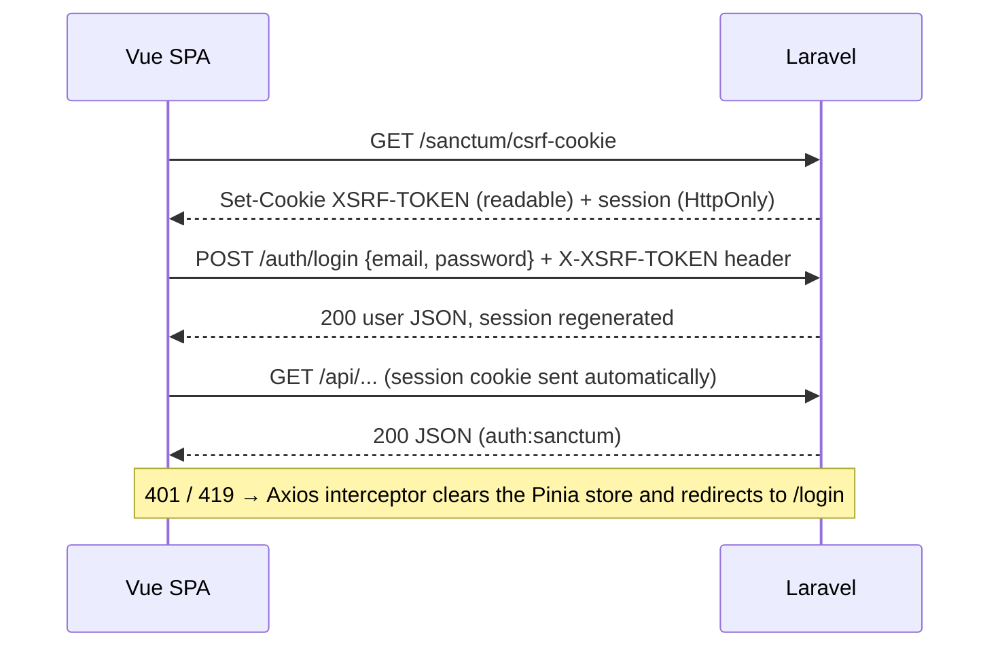

# StockFlow


**StockFlow** is a small inventory & purchase-order app for a multi-branch food business (a fictional sandwich & coffee chain in Chile). Branches keep stock of shared products, staff raise **purchase orders**, a manager **approves** them, and when the goods arrive the order is **received** and branch stock goes up. The dashboard shows which branch is running low on what.

It is a personal portfolio project built to show how I like to structure a **Laravel API + Vue 3 SPA**: thin HTTP layer, business rules in plain PHP, cookie-based SPA auth and a test suite that runs in CI.



| Purchase order (approved, ready to receive) | New purchase order (prefilled from a low-stock alert) |
| --- | --- |
|  |  |

## Features

- **Branches & products:** a shared catalog (SKU, unit, minimum stock) and stock per branch.
- **Purchase orders:** a lifecycle of `draft → approved → received` with lines and totals in CLP. Receiving an order increases the branch's stock inside one transaction.
- **Low-stock alerts:** every (branch, product) pair below the minimum, with a one-click **Reorder** that prefills a new order.
- **Roles:** *managers* maintain the catalog and approve orders. *Staff* create and receive orders.
- **SPA auth with Laravel Sanctum:** HttpOnly session cookie plus CSRF protection, with no tokens in `localStorage`.

## Stack

| Layer | Tech |
| --- | --- |
| Backend | PHP 8.3+, **Laravel 13**, Laravel Sanctum, SQLite by default (any Laravel-supported DB works) |
| Frontend | **Vue 3** (Composition API, `<script setup>`, TypeScript), Vue Router, **Pinia**, Axios, Tailwind CSS 4, Vite |
| Quality | **Pest** (feature, unit and architecture tests), Laravel Pint, `vue-tsc`, GitHub Actions |

## Architecture

Most of the app is regular Laravel. The **purchasing module** is the part with real business rules, so it follows a pragmatic hexagonal (ports & adapters) structure:



Dependencies point inward: **Infrastructure → Application → Domain**. The domain knows nothing about Laravel, and `PurchaseOrdersServiceProvider` binds each port (interface) to its Eloquent adapter. An architecture test (`tests/Unit/ArchitectureTest.php`) fails the build if the domain or application layers import `Illuminate\*`, Eloquent models or HTTP classes.

### Folder structure

```text
app/
├── Domain/PurchaseOrders/            # Business rules, no framework code
│   ├── PurchaseOrder.php             # Aggregate root: draft(), approve(), receive(), total()
│   ├── PurchaseOrderStatus.php       # draft → approved → received transitions
│   ├── PurchaseOrderLine.php         # Value objects: line, Quantity, StockMovement
│   ├── Quantity.php
│   ├── StockMovement.php
│   ├── PurchaseOrderRepository.php   # Port
│   ├── StockLedger.php               # Port
│   └── Exceptions/                   # InvalidPurchaseOrder, InvalidStatusTransition, NotFound
├── Application/
│   ├── PurchaseOrders/               # Use cases + DTOs
│   │   ├── CreatePurchaseOrder.php
│   │   ├── ApprovePurchaseOrder.php
│   │   ├── ReceivePurchaseOrder.php
│   │   └── Data/                     # CreatePurchaseOrderData, PurchaseOrderLineData
│   └── Shared/                       # Clock, TransactionManager ports
├── Infrastructure/
│   ├── PurchaseOrders/               # Eloquent adapters (repository, stock ledger)
│   └── Shared/                       # SystemClock, DatabaseTransactionManager
├── Http/
│   ├── Controllers/Api/              # Thin controllers (plain CRUD for branches/products)
│   ├── Controllers/Auth/             # Session login/logout for the SPA
│   ├── Requests/                     # Form Requests (StorePurchaseOrderRequest::toData())
│   └── Resources/                    # API Resources
├── Models/                           # Eloquent models (persistence only)
├── Policies/                         # Branch, Product, PurchaseOrder policies
├── Queries/LowStockQuery.php         # Read model for low-stock alerts
└── Providers/PurchaseOrdersServiceProvider.php   # Port → adapter bindings

resources/ts/                         # Vue 3 + TypeScript SPA
├── api/http.ts                       # Axios instance + 401/419 interceptor
├── api/*.ts                          # Typed API services (catalog, purchaseOrders, auth)
├── stores/auth.ts                    # Pinia store (current user, login/logout)
├── router/index.ts                   # Routes + auth guard
├── composables/                      # useAsync (loading/error), formatting helpers
├── components/ · layouts/ · views/
└── types/index.ts                    # API types

tests/
├── Unit/Domain/                      # Aggregate & status rules (no Laravel, no DB)
├── Unit/Application/                 # Use cases with in-memory adapters
├── Unit/ArchitectureTest.php         # Layering rules (Pest arch)
├── Feature/                          # HTTP tests: auth, catalog, PO lifecycle, dashboard
└── Support/                          # InMemory repository/ledger, FrozenClock
```

## Authentication flow (Sanctum SPA mode)

The Vue app is served by Laravel from the same origin, so it uses Sanctum's **cookie-based** authentication instead of API tokens:



- The session cookie is **HttpOnly**, so JavaScript, including any injected script, cannot read it. Nothing auth-related goes into `localStorage`.
- Axios is configured with `withCredentials` and `withXSRFToken`, so it copies the `XSRF-TOKEN` cookie into the `X-XSRF-TOKEN` header. State-changing requests without it get **419**.
- `statefulApi()` in `bootstrap/app.php` enables session auth for `/api/*` requests coming from the SPA's domain (see `SANCTUM_STATEFUL_DOMAINS`).
- Router guards only decide which screen to show. **Authorization always happens on the server** with policies (e.g. only managers can approve).

## Getting started

Requirements: PHP 8.3+ with `pdo_sqlite`, `mbstring`, `xml`, `curl`, `zip`, `bcmath`, `intl`, Composer 2, and Node 20+.

```bash
git clone https://github.com/israel-jensen/stockflow.git
cd stockflow

composer install
cp .env.example .env
php artisan key:generate
php artisan migrate --seed      # creates database/database.sqlite if needed and loads demo data

npm install
```

Run it, either with everything in one command:

```bash
composer run dev                # Laravel server + queue + logs + Vite
```

or with the two processes separately:

```bash
php artisan serve               # http://localhost:8000
npm run dev                     # Vite dev server with HMR
```

Open <http://localhost:8000> and sign in with one of the demo users:

| Role | Email | Password |
| --- | --- | --- |
| Manager | `demo@stockflow.test` | `password` |
| Staff | `staff@stockflow.test` | `password` |

> `composer run setup` does the whole install (dependencies, `.env`, key, migrations with seed data and an asset build) in one go.
> If you serve the app on a different host or port, add it to `SANCTUM_STATEFUL_DOMAINS` in `.env`.

## Testing

```bash
php artisan test                # or: ./vendor/bin/pest
vendor/bin/pint --test          # code style
npm run type-check              # vue-tsc
npm run build                   # production assets
```

The suite covers:

- **Domain unit tests:** status transitions (as a Pest dataset), invariants (no empty orders, no duplicated products, positive quantities), totals, and "receive returns one stock movement per line".
- **Use case tests with in-memory adapters:** receiving an approved order increases stock, while a draft order leaves stock untouched. No database, no framework.
- **Architecture tests:** the domain and application layers can't depend on Laravel, Eloquent or HTTP, and there are no `dd()`/`dump()` leftovers.
- **Feature tests:** CSRF cookie, login/logout and 401s, catalog CRUD and validation, the full PO lifecycle through HTTP with stock checks, role authorization (403), domain errors mapped to HTTP (409/422) and the dashboard's low-stock query.

GitHub Actions (`.github/workflows/tests.yml`) runs Pint and Pest on PHP 8.3 and 8.4, plus the type-check and Vite build, on every push and pull request.

## Design decisions

- **Hexagonal only where it pays off.** Purchase orders have real rules (lifecycle, invariants, stock side effects), so they get a domain model, use cases and ports. Branches and products are plain CRUD, so they use a regular controller, Form Request and Eloquent. Wrapping CRUD in repositories would add files without adding safety.
- **The domain owns the rules, and the HTTP layer translates them.** `PurchaseOrder::receive()` throws `InvalidStatusTransition`, and `bootstrap/app.php` maps it to **409 Conflict** (invalid input becomes 422, not found becomes 404). The domain never knows it's behind HTTP.
- **Policies answer "who", the domain answers "when".** `PurchaseOrderPolicy::approve()` only checks the role. Whether an order *can* be approved right now is decided by `PurchaseOrderStatus::canTransitionTo()`. The API resource combines both into `can.approve` / `can.receive` so the UI can show the right buttons.
- **Writes go through use cases, reads go straight to Eloquent or the query builder.** Index and show endpoints (and `LowStockQuery`) don't need the aggregate, so they stay simple and avoid N+1 with eager loading. This is a light form of CQRS.
- **Consistency on receive.** `ReceivePurchaseOrder` loads the order with `lockForUpdate()` and applies the status change and stock increments in one transaction (behind a `TransactionManager` port). Two people clicking "Receive" at the same time can't double the stock.
- **Money as integers.** The Chilean peso has no minor unit, so costs are stored as whole CLP integers, which avoids floating-point rounding.
- **Validation twice, on purpose.** Form Requests validate the *shape* of the input and give friendly field errors, while the domain re-checks its invariants so they hold no matter who calls the use case (a seeder, a job or a future CLI command). The demo seeder itself creates orders through the use cases.
- **Testable time and transactions.** `Clock` and `TransactionManager` are tiny ports, so use case tests run with a `FrozenClock` and no database.
- **Frontend kept boring on purpose.** All HTTP goes through one Axios instance and typed services, Pinia only holds truly global state (the session user), and composables (`useAsync`) handle loading and error state per screen.

## License

[MIT](LICENSE) © 2026 Israel Jensen
